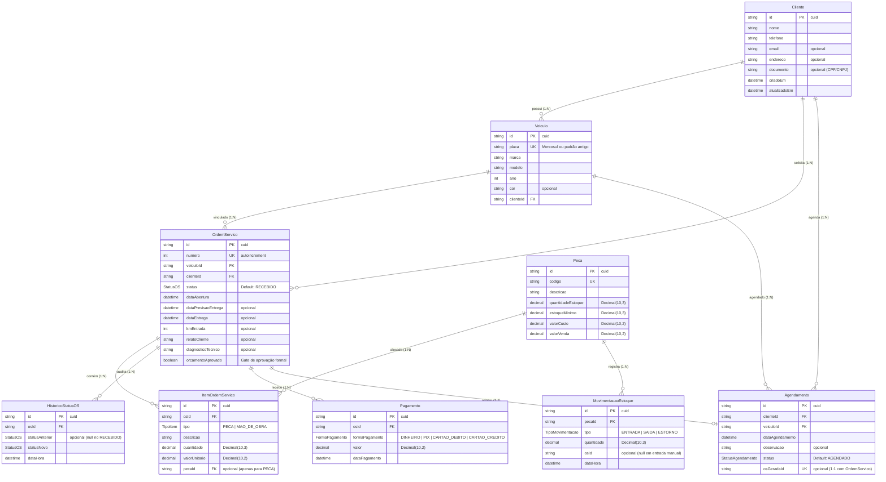

# Modelo de Dados — Sistema de Gestão para Oficina

Este documento detalha o modelo relacional implementado no banco PostgreSQL através do Prisma ORM (`prisma/schema.prisma`), rastreado pelas especificações do **OpenSpec**.

---

## 1. Diagrama Entidade-Relacionamento (ERD)

---

## 2. Enums do Sistema

### `StatusOS` (Ciclo de Vida da Ordem de Serviço)
* `RECEBIDO`: Veículo deu entrada na oficina.
* `DIAGNOSTICO`: Em avaliação técnica preliminar e elaboração de orçamento.
* `AGUARDANDO_APROVACAO`: Orçamento finalizado aguardando aceite formal do cliente.
* `APROVADO`: Orçamento formalmente aprovado (gate obrigatório para execução).
* `EM_EXECUCAO`: Mecânico executando os serviços e instalando as peças.
* `CONFERENCIA`: Controle de qualidade e inspeção final pós-serviço.
* `PRONTO_PARA_ENTREGA`: Veículo pronto para retirada pelo cliente.
* `ENTREGUE`: Veículo retirado pelo cliente (permite quitação total ou saldo pendente).
* `REPROVADO`: Orçamento recusado pelo cliente (dispara estorno automático de peças).

### `TipoItem`
* `PECA`: Peça física baixada do estoque (vinculada a `pecaId`).
* `MAO_DE_OBRA`: Serviço prestado pela oficina (não vinculada ao estoque).

### `TipoMovimentacao`
* `ENTRADA`: Adição manual de mercadorias no estoque.
* `SAIDA`: Baixa automática realizada pela inclusão de item em OS.
* `ESTORNO`: Devolução automática ao estoque por cancelamento ou reprovação de OS.

### `StatusAgendamento`
* `AGENDADO`: Marcado para comparecimento na data.
* `CONVERTIDO_EM_OS`: Convertido em Ordem de Serviço pelo botão "Gerar OS".
* `CANCELADO`: Cancelado pelo cliente ou atendente.

### `FormaPagamento`
* `DINHEIRO`, `PIX`, `CARTAO_DEBITO`, `CARTAO_CREDITO`.

---

## 3. Rastreabilidade com as Especificações (OpenSpec)

| Entidades | Spec OpenSpec | Regras de Negócio Chave |
| :--- | :--- | :--- |
| `Cliente`, `Veiculo` | `openspec/specs/clientes-veiculos/spec.md` | Placa única (Mercosul/Antiga), bloqueio de exclusão com veículo. |
| `OrdemServico`, `ItemOrdemServico`, `HistoricoStatusOS` | `openspec/specs/ordens-servico/spec.md` | Máquina de estados estrita, gate `orcamentoAprovado`, auditoria obrigatória. |
| `Peca`, `MovimentacaoEstoque` | `openspec/specs/estoque-pecas/spec.md` | Baixa na OS, estorno no `REPROVADO`, alerta de saldo negativo e reposição. |
| `Agendamento` | `openspec/specs/agendamento/spec.md` | Agrupamento por dia, conversão direta 1:1 para OS. |
| `Pagamento` | `openspec/specs/faturamento/spec.md` | Múltiplos pagamentos por OS, quitação por soma, liberação de entrega com saldo pendente (fiado). |
