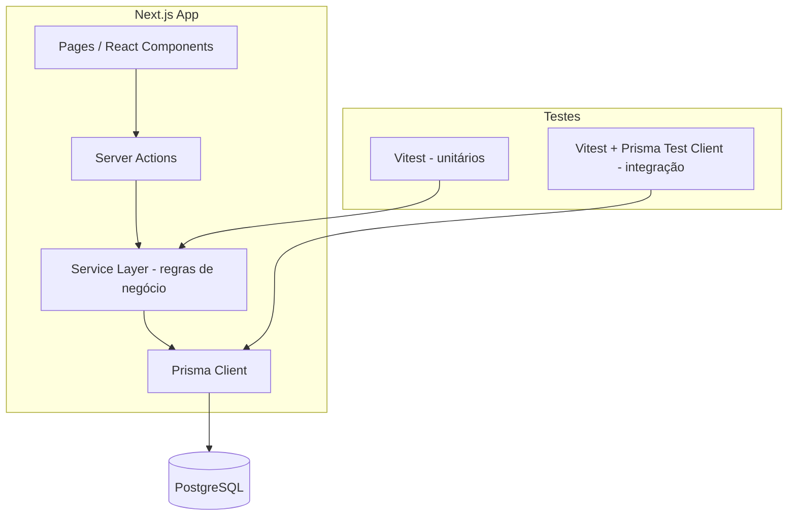
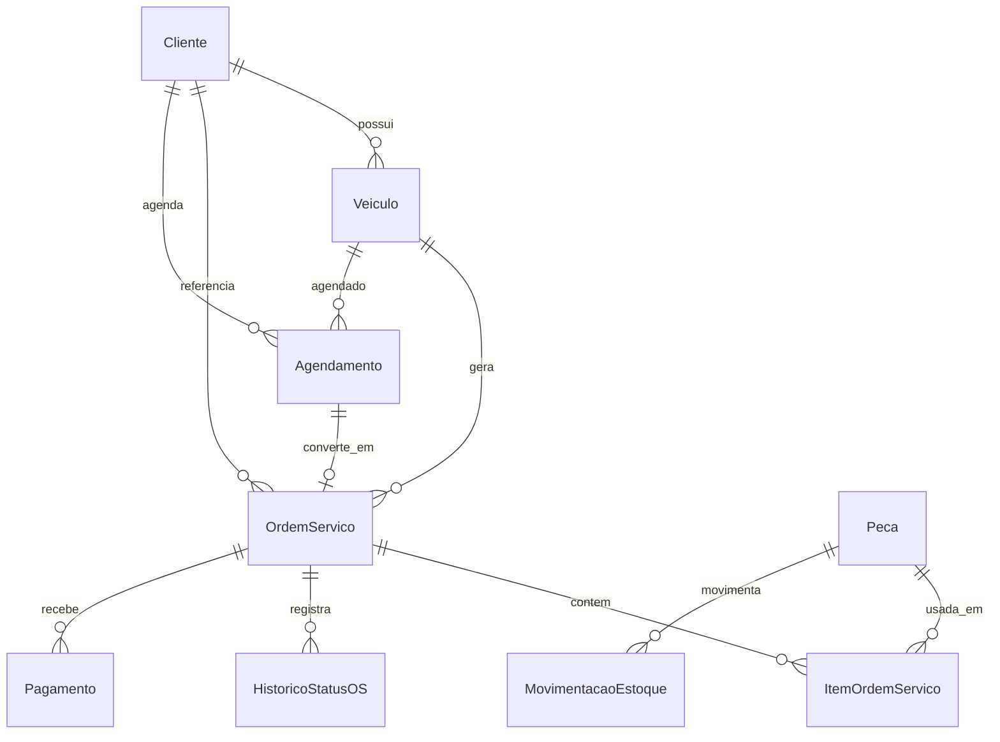

Perfeito. Tenho tudo que preciso. Deixa eu montar o plano completo.

---

## Plano de Implementação — Sistema de Gestão para Oficina

### Problema

Desenvolver um sistema de gestão para oficina mecânica, cobrindo clientes/veículos, ordens de serviço, estoque, agendamento e faturamento, seguindo as 5 specs aprovadas com desenvolvimento incremental orientado a testes.

### Requisitos

- Stack: Next.js 14 (App Router, fullstack), TypeScript, Prisma ORM, PostgreSQL, shadcn/ui + Tailwind CSS
- Testes unitários (lógica de negócio) + integração (fluxos com banco)
- Single-tenant, MVP, perfil único de usuário
- Máquina de estados formal para OS com gate de aprovação obrigatório
- Baixa/estorno automático de estoque integrado às OS
- Suporte a pagamentos múltiplos e entrega com saldo pendente

### Arquitetura Proposta

**Camadas:**
- **UI** — componentes React com shadcn/ui, rotas Next.js App Router
- **Server Actions** — ponto de entrada das mutações, validação com Zod
- **Service Layer** — lógica de negócio pura e testável (máquina de estados, cálculos, estoque)
- **Prisma Client** — acesso ao banco, migrations versionadas

### Modelo de Dados (resumo)

---

### Tarefas

**Task 1: Setup do projeto e infraestrutura base**
- Objetivo: Criar o projeto Next.js 14 com TypeScript, configurar Prisma com PostgreSQL, instalar shadcn/ui + Tailwind, configurar Vitest para testes unitários e de integração.
- Implementação: `npx create-next-app` com TypeScript e App Router, `prisma init`, configurar `vitest.config.ts` com dois workspaces (unit/integration), configurar Docker Compose com PostgreSQL para dev.
- Testes: Teste de sanidade — verificar que a conexão com o banco funciona e que o Vitest roda.
- Demo: Projeto roda localmente (`next dev`), banco sobe via Docker, suite de testes executa sem erros.

---

**Task 2: Modelo de dados completo e migrations (Spec 001–005)**
- Objetivo: Definir o schema Prisma completo com todas as entidades das 5 specs, enums de status e relações.
- Implementação: Criar `prisma/schema.prisma` com todas as models (`Cliente`, `Veiculo`, `OrdemServico`, `ItemOrdemServico`, `HistoricoStatusOS`, `Peca`, `MovimentacaoEstoque`, `Agendamento`, `Pagamento`), enums (`StatusOS`, `TipoItem`, `TipoMovimentacao`, `StatusAgendamento`, `FormaPagamento`), rodar `prisma migrate dev`.
- Testes: Teste de integração confirmando que todas as tabelas foram criadas e que as FK constraints estão ativas.
- Demo: `prisma studio` abre e exibe todas as tabelas com suas relações.

---

**Task 3: Spec 001 — CRUD de Clientes e Veículos (backend)**
- Objetivo: Implementar a service layer e Server Actions para cadastro, busca e edição de clientes e veículos com todas as regras de negócio.
- Implementação: `src/services/clientes.ts` e `src/services/veiculos.ts` com funções puras. Validação de placa única (padrões antigo e Mercosul via regex). Bloqueio de exclusão de cliente com veículos. Server Actions com validação Zod.
- Testes: Unitários para validação de placa (ambos os formatos), bloqueio de duplicata, bloqueio de exclusão. Integração para busca por nome/telefone/placa.
- Demo: Funções de service testadas e passando; chamada direta via Server Action retorna os dados corretos.

---

**Task 4: Spec 001 — UI de Clientes e Veículos**
- Objetivo: Construir as páginas de listagem, cadastro e edição de clientes e veículos com shadcn/ui.
- Implementação: Rotas `/clientes` (listagem + busca), `/clientes/novo`, `/clientes/[id]` (detalhe + veículos vinculados), `/clientes/[id]/veiculos/novo`. Componentes: tabela de clientes, formulário de cliente, formulário de veículo, feedback de erro de placa duplicada.
- Testes: Teste de integração do fluxo completo: cadastrar cliente → adicionar veículo → buscar pela placa.
- Demo: Fluxo completo navegável no browser — cadastra cliente, adiciona veículo, busca pela placa e encontra o cliente.

---

**Task 5: Spec 002 — Máquina de estados e regras de OS (backend)**
- Objetivo: Implementar a máquina de estados da OS, o gate de aprovação e o histórico de auditoria como lógica pura e testável.
- Implementação: `src/services/ordemServico.ts` com a função `transicionarStatus(osId, novoStatus)` que valida transições permitidas, bloqueia avanço sem aprovação, registra `HistoricoStatusOS`. Funções para abertura de OS, adição de itens, recálculo de valor total.
- Testes: Unitários para cada transição válida e inválida da máquina de estados. Teste do gate de aprovação (tentativa de ir para `EM_EXECUCAO` sem aprovação deve lançar erro). Teste de adição de item extra pós-aprovação exigindo nova aprovação.
- Demo: Suite de testes unitários da máquina de estados 100% verde, cobrindo todos os casos da spec.

---

**Task 6: Spec 002 — UI de Ordens de Serviço**
- Objetivo: Construir as páginas de criação, acompanhamento e detalhamento de OS com controles de transição de status.
- Implementação: Rotas `/ordens` (listagem com filtro por status), `/ordens/nova`, `/ordens/[id]` (detalhe com timeline de status, itens, botões de transição). Componente de aprovação de orçamento (modal de confirmação). Badge visual por status.
- Testes: Integração do fluxo completo: abrir OS → diagnosticar → orçar → aprovar → executar → entregar.
- Demo: OS criada e navegável no browser, botões de transição só aparecem/funcionam para os próximos status válidos, histórico de status visível na página.

---

**Task 7: Spec 003 — Estoque de Peças com integração à OS (backend)**
- Objetivo: Implementar o controle de estoque com baixa/estorno automático integrado à OS.
- Implementação: `src/services/estoque.ts` com `baixarEstoque(pecaId, quantidade, osId)`, `estornarEstoque(osId)`, `alertasReposicao()`. Integrar chamadas de baixa dentro de `adicionarItemOS` e estorno no `transicionarStatus` para `REPROVADO`. Saldo pode ficar negativo com alerta.
- Testes: Unitários para baixa, estorno e saldo negativo com alerta. Integração: adicionar peça à OS → verificar saldo; reprovar OS → verificar estorno.
- Demo: Adicionar peça à OS reduz estoque em tempo real; reprovar OS devolve as peças; peça com estoque zerado gera alerta mas permite inclusão.

---

**Task 8: Spec 003 — UI de Estoque**
- Objetivo: Construir as páginas de gestão de peças, lançamento de entradas e painel de reposição.
- Implementação: Rotas `/estoque` (listagem com destaque para peças abaixo do mínimo), `/estoque/nova`, `/estoque/[id]` (edição + histórico de movimentações). Componente de alerta de estoque insuficiente no formulário de OS.
- Testes: Integração: cadastrar peça → lançar entrada → associar à OS → verificar movimentações.
- Demo: Painel de estoque com peças em alerta destacadas; histórico de movimentações visível por peça.

---

**Task 9: Spec 004 — Agendamento com conversão em OS**
- Objetivo: Implementar o fluxo de agendamento por data e a conversão direta em Ordem de Serviço.
- Implementação: `src/services/agendamento.ts` com criação, cancelamento e `converterEmOS(agendamentoId)` que abre a OS com dados pré-preenchidos e marca o agendamento como `CONVERTIDO_EM_OS`. UI: `/agenda` (visão de lista/dia), `/agenda/novo` com busca de cliente existente ou cadastro rápido, botão "Gerar OS" na listagem.
- Testes: Unitários para transições de status do agendamento. Integração: criar agendamento → converter em OS → verificar OS criada com status `RECEBIDO` e agendamento com status `CONVERTIDO_EM_OS`.
- Demo: Agendamento do dia visível, clique em "Gerar OS" abre a tela de OS já com cliente e veículo preenchidos.

---

**Task 10: Spec 005 — Faturamento e controle de pendências (backend)**
- Objetivo: Implementar o registro de pagamentos múltiplos, cálculo de quitação e listagem de pendências.
- Implementação: `src/services/faturamento.ts` com `registrarPagamento(osId, forma, valor)`, `calcularSaldo(osId)`, `listarPendencias()`. Regras: soma de pagamentos ≥ valor da OS = quitado; entrega com saldo pendente permitida; alerta para valor pago maior que o total.
- Testes: Unitários para quitação total, pagamento parcial, overpayment (alerta). Integração: OS com dois pagamentos parciais → verificar saldo; entregar com saldo → aparecer na listagem de pendências.
- Demo: Suite de testes do faturamento 100% verde cobrindo os critérios de aceite da spec.

---

**Task 11: Spec 005 — UI de Faturamento e pendências**
- Objetivo: Construir a tela de fechamento financeiro da OS e a listagem de clientes com saldo pendente.
- Implementação: Componente de faturamento embutido na página da OS (`/ordens/[id]`), exibindo valor total, pagamentos lançados, saldo devedor/troco. Rota `/financeiro/pendencias` com listagem de OS entregues com saldo em aberto, filtráveis por cliente. 
- Testes: Integração do fluxo completo de pagamento fracionado e verificação da listagem de pendências.
- Demo: Tela de OS mostra painel financeiro; é possível lançar dois pagamentos parciais e ver o saldo atualizar em tempo real; `/financeiro/pendencias` lista OS com débito em aberto.

---

**Task 12: Integração final, navegação e polish**
- Objetivo: Conectar todos os módulos em uma navegação coesa, revisar consistência visual e garantir que todos os fluxos cross-spec funcionam de ponta a ponta.
- Implementação: Layout com sidebar de navegação principal, breadcrumbs, links entre módulos (ex: clicar no cliente de uma OS vai para o perfil do cliente, agendamento leva à OS gerada). Revisar tratamento de erros e estados de loading globalmente.
- Testes: Teste de integração end-to-end do fluxo principal: agendar → converter em OS → diagnosticar → orçar → aprovar → executar → conferir → pagar → entregar → verificar pendência zerada.
- Demo: Sistema navegável de ponta a ponta, cobrindo o fluxo completo de atendimento de um veículo desde o agendamento até a entrega com quitação.

---

Esse plano cobre as 5 specs na ordem de dependência correta, com cada task entregando um incremento testável e demonstrável. O fluxo segue: infraestrutura → dados → backend com testes → UI, repetido por spec.

Esse plano está bom, ou quer ajustar alguma coisa?